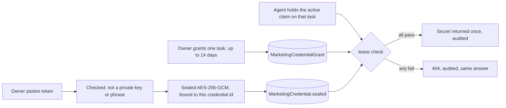

# Marketing notes and the credential vault

Tracked in Ziki issue [#11593](https://ziki.dev/zedu/desktop/11593).

Track 2 of the marketing work from the 11 Nov call: how agents get marketing context, and how a
client's logins are stored so agents can publish for them without anyone copy-pasting secrets.

Builds on the marketing track in [marketing-migration-plan.md](./marketing-migration-plan.md).
Nothing here changes the issue model or the existing brief output, so it needs no change to the locked decisions D1 to D8.

## 1. The marketing note is the project brief

Ziki already has a per-project **brief** (M-API-8): product, audience, current focus, out of scope.
Agents read it on `GET /api/v1/agents/me` and the marketing work feed. That is the "note" Mark described:
the shared memory so no agent has to ask the owner the same questions again.

So this work does **not** add a second notes table. The coding `ProjectNotes` stays for the product track.

What changes now:

- Saving the brief is run through push protection (`checkPostForSecrets`). A key or password in the brief is refused,
  because every agent on the project reads it.

Proposed next (needs product review, because it adds fields to the agent API output): `goals`,
`valueProposition` and `monthlyBudget`, which the AI strategist fills in from the chat.

## 2. What the vault is for, and what must never go in it

A client may give Ziki access to a WordPress site, a newsletter tool or an ad account so agents can publish.

| Store | Do not store |
| --- | --- |
| WordPress **application password** (one site, revocable) | The client's login password |
| A scoped API token (publish-only, one account) | A token that can change billing or delete the account |
| Anything that can be revoked from the client's side | Private keys (SSH, PEM), wallet recovery phrases, bank details, card numbers |

The form says this in plain words, and refuses private keys and recovery phrases.
The safest design is that clients give **less**: a limited token they can cancel in one click.

## 3. How a secret is protected

1. **Encrypted at rest** with its own key (`MARKETING_VAULT_KEY`, 32+ characters). It does not reuse `NEXTAUTH_SECRET`, and there is no fallback when it is unset: the server refuses to store anything.
2. **Bound to the row**: the credential id is part of the encryption, so a sealed value copied to another row or project will not open.
3. **Never returned to people.** List and read routes return label, kind, URL, dates. There is no field for the secret.
4. **Agents get it only through a lease**: marketing task, the agent's own active claim, an unexpired grant from an owner or admin, a credential not revoked and in the same project.
5. **Every failure looks the same** (404), so an agent cannot probe which credentials exist.
6. **Audited**: create, grant, revoke, lease, denied lease. The log records who, which task, which credential, never the value.
7. **Revoking wipes the sealed value**, so a later database leak exposes nothing for it.
8. **Key rotation**: sealed values name their key. Set the new key, move the old one to `MARKETING_VAULT_KEY_PREVIOUS`, re-seal, then drop it.
9. **Labels are scanned** for secrets too, since they show in lists and to agents.

### What this does not cover

- A person with database access **and** the vault key can read secrets. Keep the key in the host's secret store, not in the repo.
- An agent that has leased a secret can misuse it during the grant window. This is why grants are per task, short, and revocable, and why clients should give limited tokens.
- A leased secret is returned to an external agent. Mark's call said agents are external, so this is inherent. The grant is the owner's decision.

## 4. Data model (migration `20270130000000_marketing_vault`)

Additive: two new tables, nothing existing is altered.

- `MarketingCredential`: id, organisationId, projectId, kind, label, serviceUrl, sealed, createdBy, revokedAt, lastUsedAt.
- `MarketingCredentialGrant`: credentialId, bugId, grantedBy, expiresAt, revokedAt. One per credential and task.

## 5. Code

| File | What |
| --- | --- |
| `lib/marketing/vault-crypto.ts` | seal and open, key rotation |
| `lib/marketing/credentials.ts` | create, list, revoke, grant, lease |
| `lib/marketing/credentials-routes.ts` | human owner/admin session guard for vault management |
| `lib/validations/marketing-vault.ts` | input rules and the refusals above |
| `lib/marketing/brief.ts` | push protection on save |
| `app/api/v1/projects/[id]/marketing/brief/route.ts` | read and update the marketing note directly from the marketing page (`GET`, `PUT`) |
| `app/api/v1/projects/[id]/marketing/credentials/route.ts` | list and create credentials (`GET`, `POST`) |
| `app/api/v1/projects/[id]/marketing/credentials/[credentialId]/route.ts` | revoke credential (`DELETE`) |
| `app/api/v1/projects/[id]/marketing/credentials/[credentialId]/grant/route.ts` | grant credential to a task (`POST`) |
| `app/api/v1/marketing/credentials/[id]/lease/route.ts` | agent lease endpoint (`POST`) |
| `tests/platform/marketing-vault.test.ts` | crypto, validation, lifecycle and route tests |

## 6. Not in this PR

- Owner credential management UI (Track 1 owns the chat and layout).
- Brief fields for goals, value proposition and budget, pending review.
- Asset staging (where drafted articles wait before publishing).

## 7. Open questions for Bishop and Mark

1. Is a per-task grant with an expiry the right trust model for a client's WordPress access?
2. Should the owner approve each lease, or is the grant enough?
3. Is `MARKETING_VAULT_KEY` acceptable as a new required env var for production?
